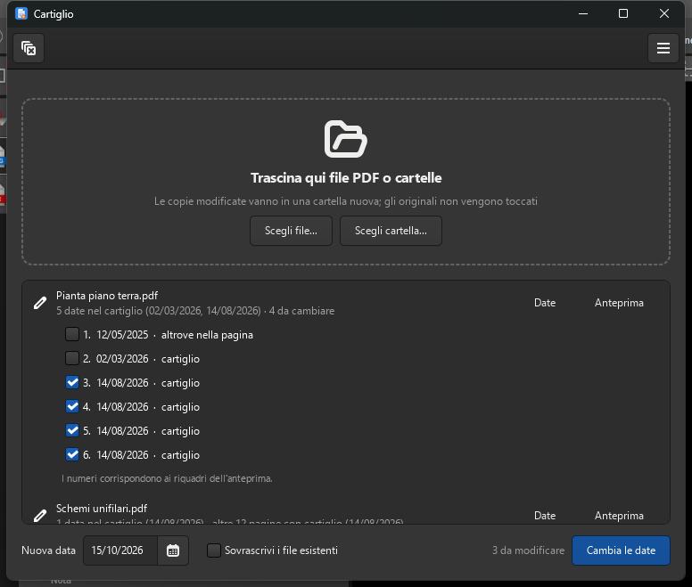

<p align="center">
  
</p>

<h1 align="center">Cartiglio</h1>

<p align="center">
  Change the dates in the title block of PDF drawings and documents, many files at once.
</p>

<p align="center">
  <a href="https://github.com/daniel-g-carrasco/cartiglio/actions/workflows/build.yml">
    
  </a>
  <a href="LICENSE"></a>
</p>

A delivery of drawings and reports is ready, exported to PDF, and then the
issue date moves. Going back to every DWG and every document to change one
date in the title block (*cartiglio* in Italian) means re-plotting the whole
set. Cartiglio changes the date in the PDFs themselves.

Drag & drop GUI (GTK 4 / libadwaita) + CLI, installable or portable on
**Windows**, Flatpak or portable on **Linux**. The changed copies go to a new
folder next to the originals, with the same names; **the originals are never
modified**.

<p align="center">
  
</p>

## What it does

- **Finds the title block.** On a drawing, the corner where labels such as
  DATA, REDAZIONE, SCALA, REV gather; dates elsewhere on the sheet (notes,
  surveys, standards) are left alone. On a report, the cover. On a set of
  sheets that repeat the block on every page (single-line diagrams), every
  page: the block is recognised by its date sitting in the same place on
  nearly all of them.
- **Changes the right dates.** By default only those equal to the most recent
  date of the block: earlier revisions keep theirs. Every date can be ticked
  or unticked by hand, with a before/after preview of the block.
- **Rewrites them cleanly.** The old glyphs are removed from the page content
  (not hidden under a white box) and the new date is written in the same
  place, font, size, colour and direction, as wide as the old one (AutoCAD's
  width factor included) and in the same format (`14/08/2026`, `14.08.26`,
  `14-8-2026`…). It is still text that can be searched and copied.
- **Checks before saving.** Every changed page is rendered again and compared
  with the original: if anything changed besides the dates, the file is not
  saved. Digitally signed PDFs are refused (the signature would break).

## Download

Grab a build from the
[**Releases**](https://github.com/daniel-g-carrasco/cartiglio/releases) page:

| Platform | File | Notes |
|---|---|---|
| Windows installer | `cartiglio-setup-*-windows-x64.exe` | Start menu entry, uninstaller, Explorer context menu on PDFs and folders (optional), built-in update check |
| Windows portable | `cartiglio-*-windows-x64-portable.zip` | unzip anywhere, run `cartiglio.exe` — no installation, no admin rights; the Explorer entry can be added from *Preferenze* |
| Linux Flatpak | `cartiglio-*-linux-x64.flatpak` | `flatpak install cartiglio-*.flatpak` (the GNOME runtime comes from Flathub) |
| Linux portable | `cartiglio-*-linux-x64-portable.tar.gz` | untar, run `./cartiglio` |

## Run from source

Python ≥ 3.9, [PyMuPDF](https://github.com/pymupdf/PyMuPDF), optionally
[fontTools](https://github.com/fonttools/fonttools) (only the digits of the
new dates get embedded, a few kB instead of the whole font) and, for the GUI,
PyGObject/GTK 4 with libadwaita 1.5 or newer. libadwaita is optional: without
it the GUI falls back to plain GTK 4.

```bash
# Debian/Ubuntu          # Fedora                          # Arch
sudo apt install python3-gi gir1.2-gtk-4.0 gir1.2-adw-1
                         sudo dnf install python3-gobject gtk4 libadwaita
                                                           sudo pacman -S python-gobject gtk4 libadwaita
pip install -r requirements.txt   # pymupdf, fonttools
python3 cartiglio.py
```

On Windows, use a release build, or MSYS2 (UCRT64):
`pacman -S mingw-w64-ucrt-x86_64-{gtk4,python-gobject,python-pymupdf,python-fonttools}`.

## CLI

The same executable works headless when given arguments (the CLI needs no
GTK):

```bash
cartiglio --dry-run drawing.pdf               # list the dates found, write nothing
cartiglio --date 16/10/2026 delivery/         # whole folder -> "delivery - 16-10-2026/"
cartiglio --date 16/10/2026 --out out/ a.pdf  # choose where the copies go
cartiglio --all drawing.pdf                   # older dates of the block too
cartiglio --all-pages | --first-page set.pdf  # force / forbid the later pages' blocks
cartiglio --check-update                      # print the latest release
cartiglio --register | --unregister           # Windows: Explorer context menu
```

Without `--date` the new date is today. A single file goes to a
`Cartiglio 16-10-2026` folder next to it; a folder is mirrored, sub-folders
included, into `<folder> - 16-10-2026`.

## How the title block is told apart

The first page is a document cover when the PDF has several pages or is A3 or
smaller: the whole page is the block. Otherwise it is a drawing, and the block
is the corner (bottom right when in doubt) holding most of the usual title
block labels, reaching about 60 mm past them. Later pages count when page 2
already has a block with a date; they are included by default when the block's
date sits in the same place on at least 80% of them.

The fonts embedded in a PDF are subsets that usually cannot write new digits,
so the date is written with the installed copy of the same font (Windows font
registry, fontconfig elsewhere, metric-compatible substitutes such as
Liberation accepted), or Helvetica when none is found, always stretched to the
width of the old date.

A note for MuPDF 1.28: when it rewrites a page for a redaction it drops the
text leading, so lines moved with `T*`, `'` or `"` jump. Cartiglio makes those
moves explicit first, which draws the same page on every version.

## Build

CI (GitHub Actions) builds everything on every push and publishes a release
for every `v*` tag: Windows with MSYS2 UCRT64 + PyInstaller + Inno Setup,
Linux with PyInstaller and Flatpak (GNOME 50 runtime). The tag must match
`__version__` in `cartiglio.py`.

```bash
python tests/test_cartiglio.py     # core, CLI, translations (needs PyMuPDF)
python tools/compile_po.py         # po/*.po -> locale/ (no gettext tools needed)
python tools/make_icon.py          # raster icons and installer bitmaps (needs Pillow)
pyinstaller --noconfirm cartiglio.spec
```

## License

[GNU AGPL-3.0](LICENSE) — the PDF engine, MuPDF/PyMuPDF, is AGPL as well.
